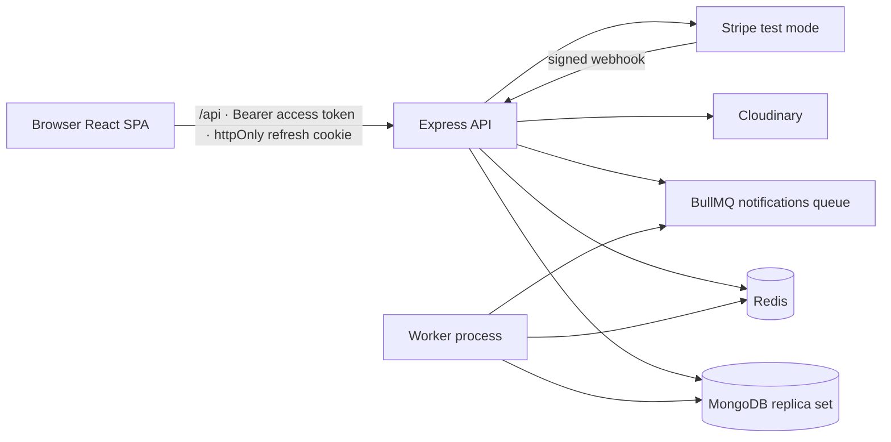

# Architecture

## Runtime shape



- **API** (`server/src/server.ts`): auth, catalogue, cart, checkout, orders, admin, webhook. It owns the transaction for reservations + order creation + coupon redemption + cart clearing.
- **Worker** (`server/src/worker.ts`): consumes `notifications`, writes Notification records, logs `[NOTIFY]`, and schedules the inventory expiry sweep every 60 seconds. It is a separate process and does not listen for HTTP.
- **MongoDB** must be a replica set because checkout and reservation release use transactions.
- **Redis** serves three purposes: catalogue cache, coupon-attempt throttling, and BullMQ. If Redis is unavailable, public reading degrades to MongoDB; durable commerce does not depend on the cache.
- **Stripe** is server-owned: the browser only receives a publishable key and a Payment Intent client secret. Webhooks are verified over raw bytes before JSON parsing.
- **Cloudinary** receives product photo bytes; MongoDB stores only `imageUrl` and `imagePublicId`.

## API middleware order

`createApp()` intentionally mounts the webhook router **before** `express.json()`:

1. request id + pino-http
2. helmet
3. CORS with credentials and exact `CLIENT_ORIGIN`
4. cookie parser
5. `/api/webhooks` (Stripe raw-body route)
6. JSON body parser (1 MB)
7. compression
8. global rate limiter
9. `/health`, resource routers, 404, centralized error handler

If the webhook were behind `express.json()`, Stripe signature verification would receive a re-serialized body and fail permanently.

## Checkout sequence

```mermaid
sequenceDiagram
  participant C as Customer browser
  participant A as API
  participant M as MongoDB
  participant S as Stripe
  participant W as Worker

  C->>A: POST /checkout/start {checkoutId}
  A->>M: load cart + compute pricing (server-owned cents)
  A->>M: transaction: guarded reservedQty++ per line + reservations
  A->>M: persist CheckoutIntent (immutable priced snapshot)
  A->>S: paymentIntents.create(amountCents, metadata{userId, checkoutId})
  S-->>A: paymentIntentId + clientSecret
  A-->>C: clientSecret + pricing
  C->>S: confirmPayment with Stripe Elements
  S-->>C: succeeded
  C->>A: POST /checkout {paymentIntentId}
  A->>S: retrieve + verify status/owner/amount/currency
  A->>M: transaction: reservations active→confirmed, stockQty--, reservedQty--, orders insert, redemption, cart clear
  A->>M: CheckoutIntent completed
  A->>W: enqueue order.created (after commit)
  A-->>C: split order DTOs
  S->>A: webhook payment_intent.succeeded (may arrive first)
  A->>M: dedupe event; fulfill from the same durable snapshot
```

### Why a durable snapshot?

The course's chapters disagree about whether orders exist before payment. FreshMarket follows the stronger invariant:

- **No order before a succeeded payment.**
- At checkout start, a `CheckoutIntent` freezes the priced lines, coupon allocation, cart item IDs, and reservation IDs.
- Payment fulfillment reads the snapshot, never the live cart or live product price.
- A webhook and a client retry can race; both call the same idempotent fulfillment path. The compound unique index `{stripePaymentIntentId, storeId}` is the database-level guard. A replay returns the existing order set.

If a reservation expired before payment succeeded, fulfillment records `needs_reconciliation` rather than silently creating an order without stock. Automatic refunds are deferred; the admin dashboard surfaces the count.

## Inventory reservations

- `Product.reservedQty` is the hold counter; `availableQty = stockQty - reservedQty`.
- Reserve uses a guarded atomic update:
  `stockQty - reservedQty >= quantity` → `$inc reservedQty`.
- A multi-line reservation runs in a transaction; one failed line rolls back all earlier holds.
- Confirm transitions `active → confirmed` and atomically decrements both `stockQty` and `reservedQty`.
- Release transitions `active → released` and decrements only `reservedQty`.
- The worker sweeps `expiresAt <= now` every minute. There is deliberately no MongoDB TTL index: deleting a reservation cannot update the product counter.
- Payment confirmation is also idempotent: if a reservation is already `confirmed`, it is skipped.

## Pricing and coupons

- Money is computed in **integer minor units** (paise by default).
- Coupon validation checks active state, window, scope, minimum subtotal, global cap, and per-user cap.
- The discount is computed once, then allocated across eligible lines proportionally by subtotal. The remainder goes to the largest eligible lines with a stable product-ID tie-breaker. The service asserts that line discounts sum exactly to the cart discount and that `subtotal - discount === total`.
- Store-scoped coupons only discount lines from that store; other stores keep their full totals.
- Order snapshots carry both the discount allocation and the coupon identity. Changing or deactivating a coupon later cannot rewrite a paid receipt.
- Coupon application is rate-limited per user and per IP via Redis counters (20/minute), with generic public errors and structured internal logs.

## Cache and search

- `GET /api/products` is cache-aside: normalized key → Redis GET → MongoDB on miss → Redis SET with TTL.
- Keys include a catalogue version. Product/store writes increment `catalogue:version`, making all prior keys unreachable.
- Only successful list payloads are cached; validation errors and 5xx responses are never cached.
- Redis failures are caught at read/write boundaries and never convert a correct MongoDB answer into a 500.
- Search uses a MongoDB text index named `product_text_search` on `name` and `category`; `$text` is combined with the same visibility filters and pagination.

## Client session model

- Access token lives in memory only.
- Refresh token is an opaque value, hashed in MongoDB, sent in an httpOnly cookie scoped to `/api/auth`.
- `apiFetch` retries one 401 after a single-flight refresh, then clears the session.
- React StrictMode double-effects do not create two refresh rotations because refresh is single-flight.
- Route guards: `CustomerRoute`, `VendorRoute`, `VendorWithStoreRoute` (404 `/stores/me` → onboarding), `AdminRoute`.

## Deployment shape

| Process | Build | Start | Required environment |
|---|---|---|---|
| API | `npm run build` (root or server) | `node server/dist/server.js` | Mongo, Redis, JWT, client origin, Stripe, Cloudinary |
| Worker | same revision as API | `node server/dist/worker.js` | Redis; Mongo if processors read orders; no JWT/Stripe needed |
| Client | `VITE_API_URL=... npm --workspace client run build` | static `dist/` + SPA fallback | publishable Stripe key only |

Dockerfiles are in `server/Dockerfile` and `client/Dockerfile`. `client/nginx.conf` includes the SPA fallback. CI runs typecheck → lint → tests → build against a MongoDB replica set and Redis.

Production notes:
- Set `NODE_ENV=production`, `COOKIE_SECURE=true`, exact `CLIENT_ORIGIN`, and HTTPS.
- `VITE_API_URL` is baked at build time; rebuild the client when it changes.
- Deploy API and worker from the same commit so queue names/payloads agree.
- Register the Stripe webhook at `https://<api>/api/webhooks/stripe` and use its signing secret.
- Do not expose MongoDB/Redis ports publicly.
