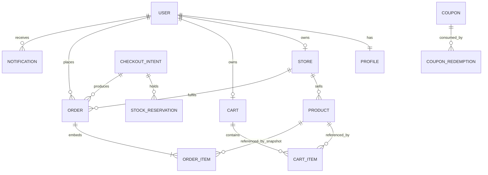
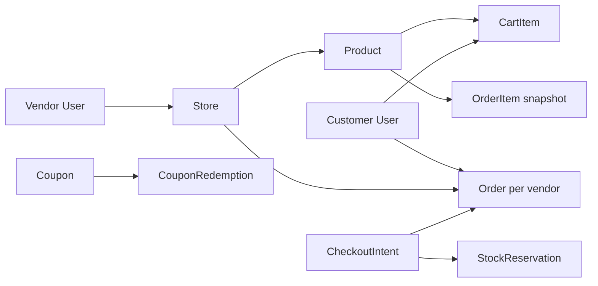

# Entity relationship diagram

FreshMarket uses MongoDB with Mongoose. References are used for live ownership; order lines are embedded snapshots so receipts never change when a product is edited.

## Collections

### users
`email` (unique, lowercase), `passwordHash`, `role` (`vendor|customer|admin`), `isVerified`, `otpHash`, `otpExpiresAt`, `refreshTokenHash`, `refreshTokenExpiresAt`, timestamps.

Sensitive fields are stripped in `toJSON`; API responses never include password/OTP/refresh hashes.

### profiles
`userId` (unique ref User), `displayName`, `phone?`, `avatarUrl?`, timestamps.

### stores
`name`, `slug` (unique), `description?`, `address?`, `logoUrl?`, `logoPublicId?`, `userId` (unique ref User), `isActive`, timestamps.

One vendor owns at most one store. A suspended store (`isActive: false`) is hidden from the public catalogue but remains visible to its vendor.

### products
`name`, `description?`, `price` (major units), `unit` (`each|bunch|kg|g|L|ml|pack`), `weightOrQuantity?`, `stockQty`, `reservedQty`, `isPerishable`, `category` (`produce|dairy|bakery|pantry|frozen|beverages|household`), `isPublished`, `isActive`, `imageUrl?`, `imagePublicId?`, `storeId` (ref Store), timestamps.

`availableQty = max(0, stockQty - reservedQty)` is computed for reads. Indexes: `storeId`, `storeId+isPublished`, catalogue filter, and text index `product_text_search` on `name`/`category`.

### carts
`userId` (unique), `appliedCouponCode?`, timestamps. One cart per customer; coupon intent lives here until checkout.

### cartitems
`userId`, `productId`, `storeId`, `quantity`, timestamps. Unique `{userId, productId}`; the `storeId` is denormalized so checkout can split without re-reading the product.

### orders
One document per vendor for one checkout.

Top-level: `customerId`, `storeId`, `checkoutId`, `status` (`pending|packed|dispatched|cancelled`), `paymentStatus` (`pending|paid|failed`), `stripePaymentIntentId`, `orderItems[]`, `subtotalCents`, `discountCents`, `totalCents`, `subtotal`, `discountTotal`, `total`, `couponCode?`, `couponScope?`, `pricingVersion`, `paidAt?`, timestamps.

Unique index `{stripePaymentIntentId, storeId}`; indexes on customer/store + createdAt.

Embedded `orderItems[]`: `productId`, `nameAtPurchase`, `unitAtPurchase`, `quantity`, `priceAtPurchase`, `priceAtPurchaseCents`, `lineSubtotalCents`, `discountCents`, `lineTotalCents`, `lineTotal`. These are write-once receipts.

### stockreservations
`productId`, `storeId`, `quantity`, `status` (`active|confirmed|released`), `checkoutId`, `paymentIntentId?`, `expiresAt`, `confirmedAt?`, `releasedAt?`, timestamps.

Unique `{checkoutId, productId}`; expiry index `{expiresAt, status}`. No MongoDB TTL index — deletion cannot decrement `reservedQty`; the worker owns the transition.

### checkoutintents
Durable checkout snapshot: `checkoutId` (unique), `userId`, `stripePaymentIntentId?` (unique sparse), `currency`, `amountCents`, `cartFingerprint`, `pricingSnapshot`, `cartItemIds[]`, `reservationIds[]`, `status` (`created|awaiting_payment|paid|completed|failed|expired|needs_reconciliation`), `orderIds[]`, `stripeEventIds[]`, `expiresAt`, timestamps.

This is the bridge between “customer clicked pay” and “orders exist”: it freezes the priced lines before Stripe, so payment fulfillment never reads a mutable cart.

### coupons
`code` (unique uppercase), `scope` (`platform|store`), `storeId?`, `type` (`percent|fixed_cents`), `value`, `maxDiscountCents?`, `minSubtotalCents`, `startsAt`, `endsAt`, `maxRedemptions?`, `maxRedemptionsPerUser`, `redemptionCount`, `isActive`, timestamps.

### couponredemptions
`couponId`, `userId`, `checkoutId`, `paymentIntentId`, `orderIds[]`, `discountCents`, timestamps. Unique `{couponId, checkoutId}` and `{paymentIntentId}`; index `{couponId, userId}` for per-user caps.

### stripeevents
`eventId` (unique), `type`, `paymentIntentId?`, `checkoutId?`, `summary`, `processedAt?`, timestamps. Webhook deliveries are at-least-once; this is the dedupe ledger.

### notifications
`userId`, `type` (`order.created|order.status_updated`), `title`, `body`, `orderId?`, `readAt?`, timestamps. Written by the worker and logged as `[NOTIFY]` lines for local demos.

## Ownership chain

